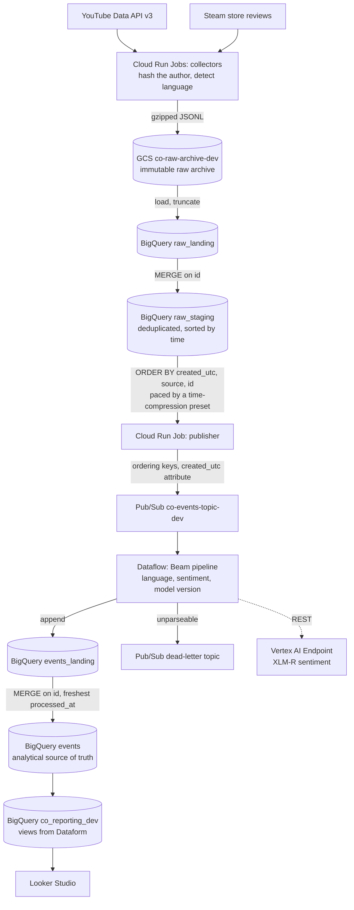

# Architecture

How a comment written by a stranger becomes a point on a sentiment curve,
and why each hop exists. Module-level detail lives in the `README.md` of
each directory; binding decisions live in [`adr/`](adr/).

## The path a record takes

## Why each hop exists

**Two sources, not one.** Reddit was refused API access, and Steam reviews
replaced it ([ADR 0001](adr/0001-steam-replaces-reddit-as-second-source.md)).
That is not only about volume: the ordering guarantee below is only
*exercised* when records arrive from clocks that know nothing about each
other. Steam also hands over the author's own thumbs up/down (`voted_up`),
which evaluates the classifier at a scale no hand-labelled set reaches.

**GCS holds the raw payloads, BigQuery holds the analysis.** Both are
first-class. If the model changes or the schema changes, the replay is
regenerated from the archive, not from the internet — the external APIs
may be gone, rate-limited, or simply different by then.

**A publisher sits between BigQuery and Pub/Sub** because global
chronological ordering *across sources* is a requirement, and Pub/Sub
cannot provide it. BigQuery's `ORDER BY` is total, so the archive is sorted
there and streamed out under Pub/Sub ordering keys, with `created_utc` as a
message attribute so Beam's watermark follows event time rather than
delivery time. That is also what makes a replay a replay: the publisher
paces the stream by a time-compression preset instead of dumping rows.

**Landing tables in front of both warehouse tables.** `raw_landing` and
`events_landing` are append-or-truncate targets; a MERGE keyed on `id`
promotes rows into `raw_staging` and `events`. The pipeline is therefore
free to be at-least-once, which is what Pub/Sub and Dataflow actually
guarantee, and a replay can be repeated without duplicating rows.

**The NLP model is swappable and remote.** The pipeline calls a classifier
behind one interface; the stub is deterministic and free, and XLM-R is
served from a Vertex AI Endpoint. The model's weights are deliberately not
baked into the pipeline image: Dataflow workers run without public IPs and
reach Google APIs over Private Google Access only, so an image that tried
to fetch weights at start-up would hang, and an image that carried them
would have to be rebuilt to change models.

**Training is tracked on an MLflow server, not on the machine that
trains.** Parameters, metrics and the model registry live in Postgres
(Cloud SQL) behind a Cloud Run service. IAP lets in the same people who
can open the dashboard. Weights go straight to GCS beside the rest of
the NLP artifacts. Before this, the run history was a directory on the
Workbench disk that nobody else could see
([ADR 0004](adr/0004-mlflow-tracking-server-on-cloud-run-and-cloud-sql.md)).

## What is reproducible, and how

Every number in the thesis has to be regeneratable from the raw archive
plus committed code at a known commit. Three mechanisms make that true:

1. **A replay is one Cloud Build run** — commit, parameters, coverage check
   and fingerprint in a single log
   ([ADR 0002](adr/0002-replay-runs-as-one-build-with-a-completeness-gate.md)).
2. **The fingerprint** hashes every column of `events` except
   `model_version` and `processed_at`, which differ per run by
   construction. The same replay twice gives the same fingerprint; it
   survived a change of orchestration and of image reference
   ([phase-1-dataflow.md](phase-1-dataflow.md)).
3. **The promotion cannot run early.** The build waits until every staged
   id has landed in that run before draining, and a run that does not
   complete is never promoted.

## Privacy by design

Author handles never reach storage. The collectors replace them at the
record boundary with `SHA-256(handle + salt)` truncated to 16 hex
characters, with the salt in Secret Manager; for Steam, `personaname` and
`profile_url` are dropped and only the hashed `steamid` survives. The
reporting views the dashboard reads expose neither the author hash nor the
comment text — author counts are computed inside the aggregates. Handles
are treated as personal data under GDPR, so this is a boundary, not a
preference.

## Infrastructure and delivery

Everything is Terraform (`terraform/modules/`, composed in
`terraform/envs/dev/`), applied by Cloud Build behind a manual approval;
laptops run `terraform plan` only. The one exception is the SQL of the
reporting views and their metrics: a Dataform project in the repository
root, tested by assertions and deployed on every merge
([ADR 0003](adr/0003-reporting-sql-in-dataform.md)). Images are built per service, tagged
with the full commit SHA and deployed to Cloud Run Jobs **by digest**, so a
job always runs the exact image a commit produced. The env's canonical
variables live in a Secret Manager secret rather than on anyone's laptop.

Cost control is part of the design, not an afterthought: a streaming
Dataflow job is the most expensive resource here, so nothing but an
explicit manual trigger starts one, every replay build drains its job even
on failure, and alerts fire on a job left running, an ageing replay
backlog, dead-lettered records and a monthly budget threshold
(`terraform/modules/monitoring/`).

## Known asymmetries

- **Steam starts at launch.** Pre-launch events — the reveal, the
  trailers, the release-date reveal — are YouTube-only by construction.
  The analysis reports that rather than hiding it.
- **YouTube is curated plus sparing search.** A manually maintained list
  of canonical videos is the primary signal, because `search.list` costs
  100 quota units against a daily 10,000.
- **Steam can only be read newest-first**, so a historical collection is
  one long walk tagged per record, not one run per event
  ([`collectors/steam/README.md`](../collectors/steam/README.md)).
